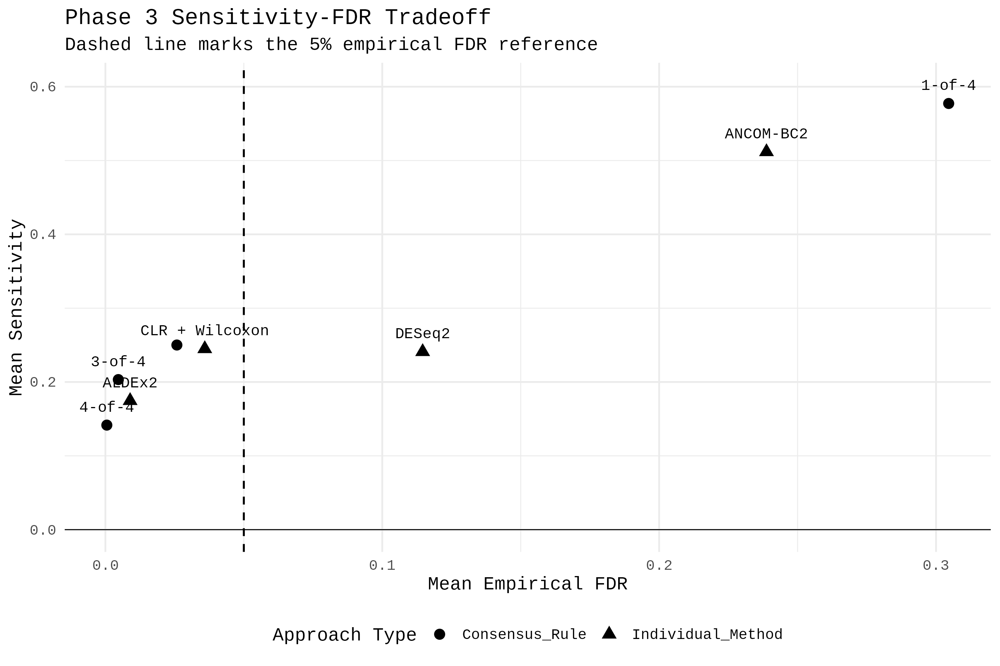
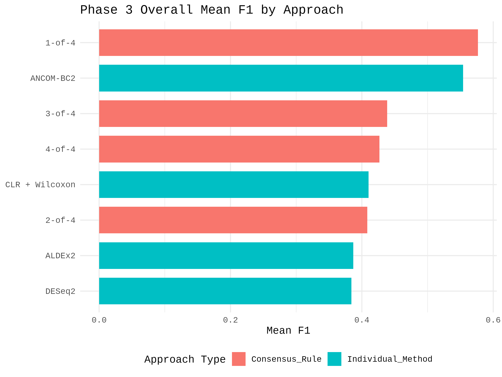
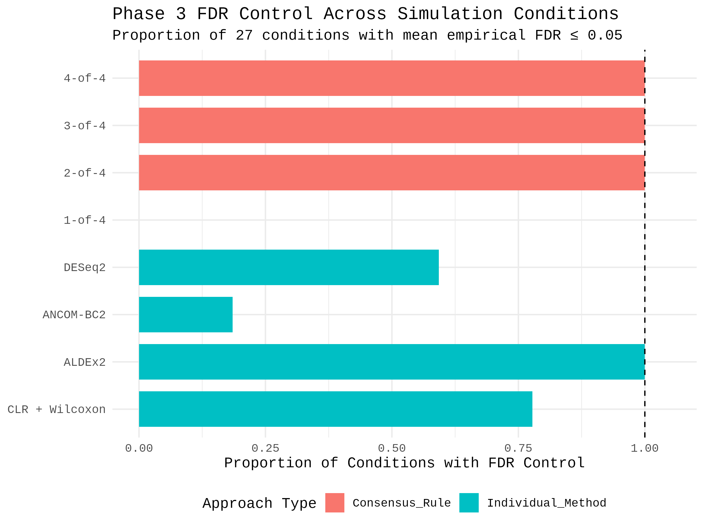
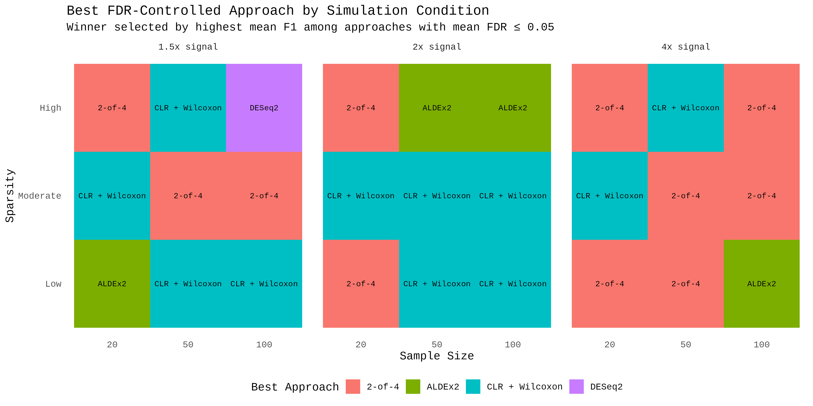
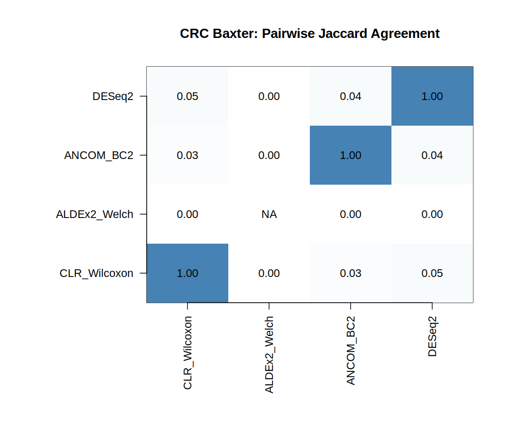

# BIOT670I Microbiome Group Project

## Microbiome Abundance Consensus Machine

This repository contains the code, datasets, analyses, figures, and results for the BIOT670I microbiome capstone project. The project compares four differential-abundance (DA) methods across simulated microbiome datasets with known ground truth and real microbiome data with unknown ground truth. It also evaluates whether consensus voting can provide a more reliable set of candidate differential taxa.

**Methods:** CLR/Wilcoxon, ALDEx2 Welch, ANCOM-BC2, and DESeq2.

## Project Status

| Component | Status |
| --- | --- |
| Project planning and simulation framework | Complete |
| Phase 1: Null calibration | Complete |
| Phase 2: Signal simulation and performance evaluation | Complete |
| Phase 3: Extended simulation benchmark | Complete |
| Phase 3: Consensus evaluation | Complete |
| Phase 4: Real-data preprocessing and quality control | Complete |
| Phase 4: Four-method differential-abundance analysis | Complete |
| Phase 4: Cross-method agreement and consensus analysis | Complete |
| Phase 4: Results and scientific interpretation | Complete |

**All four analytical phases are complete.** This repository documents their outputs and the scientific interpretation, including methodological limitations.

## Research Questions

- How do differential-abundance methods respond to changing signal strength and microbiome data characteristics?
- How do sensitivity and false-discovery control differ across methods?
- Can rules based on agreement among methods improve robustness?
- How much do methods agree when applied to real microbiome data without known ground truth?

## Phase 1: Null Calibration

Repeated null simulations, in which no taxa have planted differential abundance, examine raw Type I error and the probability of any false discovery after Benjamini-Hochberg (BH) correction.

Outputs: [Phase 1 summary and figures](results/README.md), including [raw Type I error](results/phase1_raw_type1_error.png) and [any BH false discovery](results/phase1_any_bh_false_discovery.png).

## Phase 2: Signal Simulation

Controlled differential-abundance signals (1.5x, 2x, and 4x) were introduced into simulated datasets. The four methods were compared using sensitivity and empirical false discovery rate (FDR).

Sensitivity generally increased with signal strength, but methods differed in FDR behavior. These results illustrate a sensitivity-versus-false-discovery trade-off.

Outputs: [performance summary](results/phase2_performance_summary_8F.csv), [sensitivity](results/phase2_sensitivity_plot_8G.png), [empirical FDR](results/phase2_empirical_FDR_plot_8H.png), and [combined performance figure](results/phase2_combined_performance_plot_8I.png). See [results documentation](results/README.md).

## Phase 3: Extended Simulations and Consensus Evaluation

The completed extended benchmark evaluates the four methods over **27 simulation conditions**, with **5,400 runs per method** recorded in the overall method summary. Outputs include condition-level performance, method failure and not-evaluated summaries, consensus comparisons, and final figures.

### Individual-method performance

| Method | Mean sensitivity | Mean empirical FDR |
| --- | ---: | ---: |
| CLR/Wilcoxon | 0.245 | 0.036 |
| ALDEx2 Welch | 0.175 | 0.009 |
| ANCOM-BC2 | 0.512 | 0.239 |
| DESeq2 | 0.241 | 0.115 |

These are averages across the tested simulation conditions and do not establish universal method rankings.

### Consensus strategies

A taxon is included when at least 1, 2, 3, or all 4 methods identify it as significant.

| Voting rule | Mean sensitivity | Mean empirical FDR | Conditions meeting 0.05 FDR criterion |
| --- | ---: | ---: | ---: |
| 1-of-4 | 0.577 | 0.305 | 0/27 |
| 2-of-4 | 0.250 | 0.026 | 27/27 |
| 3-of-4 | 0.203 | 0.005 | 27/27 |
| 4-of-4 | 0.142 | 0.001 | 27/27 |

The final simulation recommendation identifies **3-of-4** as the overall consensus rule in this benchmark. The **2-of-4** rule is a higher-sensitivity option, while **4-of-4** is more conservative. Stricter agreement requirements reduce sensitivity.

Source tables: [final consensus recommendation](data/simulated/Phase3/Consensus/phase3_final_consensus_recommendation.csv), [overall comparison](data/simulated/Phase3/Consensus/phase3_final_overall_summary.csv), and [individual-method summary](data/simulated/Phase3/phase3_overall_method_summary.csv).

### Phase 3 figures









Additional checkpoints, tables, and figures: [Phase 3 directory](data/simulated/Phase3/).

## Phase 4: Real-Data Analysis and Consensus Evaluation

The completed real-data workflow uses the **Baxter colorectal cancer (CRC) dataset** from MicrobiomeHD to compare CRC cases with healthy controls. The adenoma group is excluded.

- **Samples:** 292 (120 CRC; 172 healthy)
- **Filtered OTUs:** 1,133
- **Filtering:** at least 10% prevalence (30 samples) and at least 20 total reads
- **Filtered zero fraction:** approximately 76.5%
- **Significance criterion:** BH-adjusted p-value < 0.05

The repository includes dataset and count validation, filtered count tables and metadata, four method-result tables, a combined result table, Jaccard agreement summaries, consensus outputs, and final interpretation.

### Significant OTUs by method

| Method | Significant OTUs |
| --- | ---: |
| CLR/Wilcoxon | 24 |
| ALDEx2 Welch | 0 |
| ANCOM-BC2 | 486 |
| DESeq2 | 20 |

### Cross-method consensus

| Support | OTUs |
| --- | ---: |
| At least 1 method | 494 |
| At least 2 methods | 34 |
| At least 3 methods | 2 |
| All 4 methods | 0 |

The **3-of-4 consensus identified two OTUs**, both supported by CLR/Wilcoxon, ANCOM-BC2, and DESeq2. The real dataset exhibits substantial differences across methods.



**Interpretation:** Real-data agreement is not a measure of ground-truth accuracy. True DA status is unknown, so empirical FDR and sensitivity cannot be directly determined from this dataset. The analysis does not establish agreement in effect direction or adjust for clinical covariates. ANCOM-BC2 BH-significant results have not been confirmed as pseudo-count robust. These limitations are documented in the completed interpretation; they do not imply that the analytical phase is unfinished.

Selected outputs: [method summary](data/real/crc_baxter/DA_results/crc_baxter_method_summary.csv), [Jaccard matrix](data/real/crc_baxter/DA_results/crc_baxter_jaccard_matrix.csv), [3-of-4 consensus](data/real/crc_baxter/DA_results/crc_baxter_consensus_3of4.csv), and [final interpretation](data/real/crc_baxter/DA_results/crc_baxter_final_interpretation.txt).

Dataset provenance: [Baxter dataset record](https://zenodo.org/records/840333) and [Baxter et al. (2016)](https://doi.org/10.1186/s13073-016-0290-3).

## Repository Structure

```text
Microbiome_Group_Project/
├── data/
│   ├── simulated/
│   │   └── Phase3/
│   │       ├── Phase3_Figures/
│   │       ├── Consensus/
│   │       │   ├── Phase3_Final_Figures/
│   │       │   └── Taxon_Checkpoints/
│   │       └── phase3_*.csv / *.rds
│   └── real/
│       ├── README.md
│       └── crc_baxter/
│           ├── DA_results/
│           ├── dataset_info.json
│           ├── crc_baxter_filtered_counts.csv
│           └── crc_baxter_filtered_metadata.csv
├── notebooks/
│   ├── biot670i_microbiome_project.py
│   └── README.md
├── results/
│   ├── README.md
│   └── phase1_* / phase2_* outputs
├── scripts/
├── .gitignore
└── README.md
```

This tree shows principal directories and selected files, not every intermediate checkpoint. Analyses are implemented in the project notebook workflow, with a Python export in `notebooks/`. Results, figures, and intermediary outputs are version controlled for inspection and review.

## Scientific Conclusion

Across simulated conditions, the four DA methods showed different sensitivity and false-discovery behavior. Consensus rules controlled FDR more consistently in the evaluated conditions, but with reduced sensitivity as the agreement threshold increased. Real-data analysis of the Baxter CRC dataset likewise revealed substantial method disagreement and a small 3-of-4 consensus set. Together, these results support evaluating data characteristics, method assumptions, and agreement rather than treating any single DA method as universally reliable.

## References

- Baxter et al. (2016). *Genome Medicine*. https://doi.org/10.1186/s13073-016-0290-3
- Nearing et al. (2022). Microbiome differential abundance methods produce different results across 38 datasets. *Nature Communications*, 13, 342. https://doi.org/10.1038/s41467-022-28034-z
- Hawinkel et al. (2019). A broken promise: Microbiome differential abundance methods do not control the false discovery rate. *Briefings in Bioinformatics*, 20(1), 210–221. https://doi.org/10.1093/bib/bbx104
