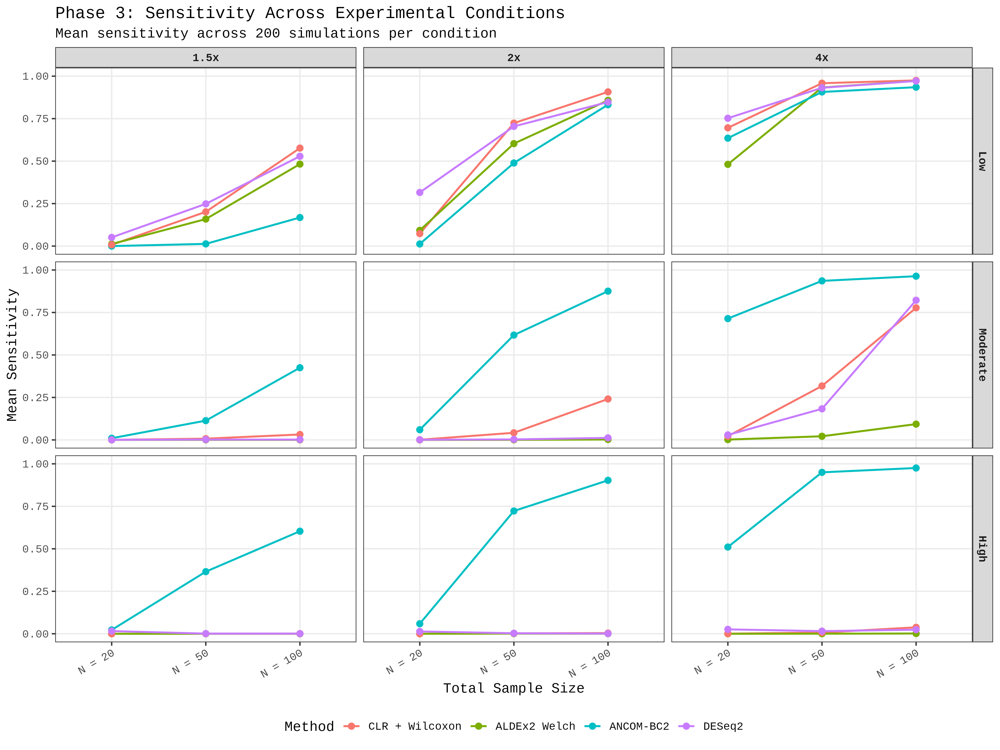
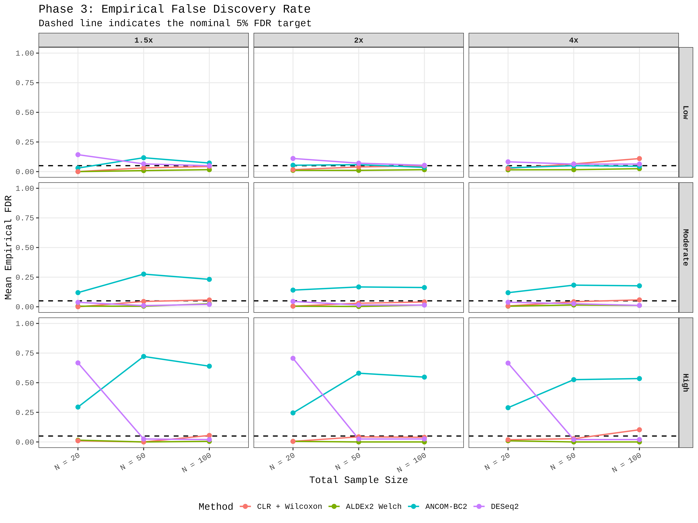
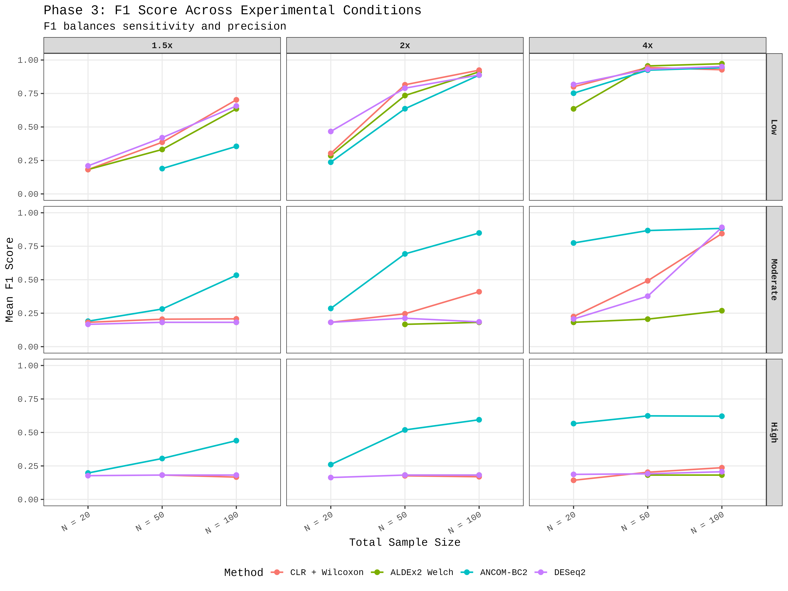

# Simulated Microbiome Data and Benchmark Results

This directory documents the **completed simulation-based analyses (Phases 1–3)** of the BIOT670I **Microbiome Abundance Consensus Machine** project. The simulations allow differential-abundance (DA) methods to be evaluated against *known planted ground truth*, unlike the real-data arm where the true differentially abundant taxa are not known.

The four methods compared are **CLR/Wilcoxon, ALDEx2 Welch, ANCOM-BC2, and DESeq2**. The benchmark measures sensitivity, empirical false discovery rate (FDR), and other performance measures, then evaluates agreement-based consensus rules.

**Simulation work status: Complete.**

## Where the results are stored

- **Phases 1 and 2:** Simulations were generated in the analysis notebook rather than committing every individual simulated count table. Their selected summary tables and figures are in [`../../results/`](../../results/), with discussion in [`../../results/README.md`](../../results/README.md).
- **Phase 3:** Extended-condition result tables, validation records, checkpoints, RDS objects, and figures are in [`Phase3/`](Phase3/). Consensus-specific outputs are in [`Phase3/Consensus/`](Phase3/Consensus/).
- **Real-data analysis (Phase 4):** See [`../real/`](../real/) and the [main project README](../../README.md); those outputs are not simulation data.

## Phase 1 — Null calibration (complete)

The first stage uses a simulated null setting, with **no planted differential-abundance signal**, to examine whether the statistical procedure produces false-positive results.

The repeated null-calibration workflow evaluates:
- Empirical raw Type I error compared with the nominal 5% reference.
- The probability of one or more false discoveries after Benjamini–Hochberg (BH) adjustment, compared with a 5% reference.
- Diagnostic behavior over repeated simulated datasets, rather than interpreting a single null run as definitive.

**Selected outputs**
- [Null calibration summary](../../results/phase1_final_calibration_summary.csv)
- [Raw Type I error figure](../../results/phase1_raw_type1_error.png)
- [Probability of any BH false discovery figure](../../results/phase1_any_bh_false_discovery.png)

## Phase 2 — Planted-signal simulations (complete)

Phase 2 introduces known differential-abundance effects at **1.5x, 2x, and 4x** signal strengths and compares the same four DA methods. Because the planted signal is known, the analyses can quantify **sensitivity** and **empirical FDR**.

In the saved summaries, sensitivity generally increased with signal strength, but the methods differed in false-discovery behavior. The evaluation therefore considers the trade-off between detecting planted signals and limiting incorrect discoveries.

**Selected outputs**
- [Phase 2 performance summary](../../results/phase2_performance_summary_8F.csv)
- [Sensitivity figure](../../results/phase2_sensitivity_plot_8G.png)
- [Empirical FDR figure](../../results/phase2_empirical_FDR_plot_8H.png)
- [Combined performance figure](../../results/phase2_combined_performance_plot_8I.png)

See [the results README](../../results/README.md) for the detailed Phase 1–2 descriptions.

## Phase 3 — Extended simulation benchmark (complete)

Phase 3 expands the benchmark to **27 simulation conditions**, with **200 completed simulations per condition** and all four methods evaluated per simulation. The [condition validation table](Phase3/phase3_condition_validation.csv) records all 27 conditions as complete.

The [overall method summary](Phase3/phase3_overall_method_summary.csv) reports **5,400 successful runs per method**, with zero failed runs in this recorded benchmark.

### Individual-method results

| Method | Mean sensitivity | Mean empirical FDR | Successful / total runs |
| --- | ---: | ---: | ---: |
| CLR/Wilcoxon | 0.245 | 0.036 | 5,400 / 5,400 |
| ALDEx2 Welch | 0.175 | 0.009 | 5,400 / 5,400 |
| ANCOM-BC2 | 0.512 | 0.239 | 5,400 / 5,400 |
| DESeq2 | 0.241 | 0.115 | 5,400 / 5,400 |

These are **averages over the tested simulation conditions** and should not be presented as performance guarantees for other datasets. ANCOM-BC2 had the highest mean sensitivity in this summary but also a substantially higher mean empirical FDR. ALDEx2 Welch showed lower mean sensitivity and lower mean empirical FDR.

**Selected Phase 3 outputs**
- [Condition/method summary](Phase3/phase3_condition_method_summary.csv)
- [Overall method summary](Phase3/phase3_overall_method_summary.csv)
- [Condition validation](Phase3/phase3_condition_validation.csv)
- [FDR-control summary](Phase3/phase3_fdr_control_summary.csv)
- [Final results](Phase3/phase3_final_results.csv)
- [Best method by condition](Phase3/phase3_best_method_by_condition.csv)

### Extended benchmark figures







Additional figures: [failure rates](Phase3/Phase3_Figures/Figure_9G_4_Failure_Rate.png) and [not-evaluated fractions](Phase3/Phase3_Figures/Figure_9G_5_Not_Evaluated.png).

## Phase 3 — Consensus evaluation (complete)

The consensus evaluation combines significance calls using four voting thresholds:
- **1-of-4:** At least one method identifies the taxon.
- **2-of-4:** At least two methods identify the taxon.
- **3-of-4:** At least three methods identify the taxon.
- **4-of-4:** All four methods identify the taxon.

The [final consensus recommendation table](Phase3/Consensus/phase3_final_consensus_recommendation.csv) reports:

| Rule | Mean sensitivity | Mean empirical FDR | Conditions meeting FDR criterion (out of 27) |
| --- | ---: | ---: | ---: |
| 1-of-4 | 0.577 | 0.305 | 0 |
| 2-of-4 | 0.250 | 0.026 | 27 |
| 3-of-4 | 0.203 | 0.005 | 27 |
| 4-of-4 | 0.142 | 0.001 | 27 |

**The saved analysis recommends 3-of-4 consensus as its overall consensus rule** across the tested conditions. It describes 2-of-4 as a higher-sensitivity FDR-controlled alternative and 4-of-4 as the most conservative rule. Increasing the required number of agreeing methods reduced sensitivity while lowering empirical FDR.

These conclusions are specific to this simulation benchmark; voting agreement alone does not guarantee biological correctness in an unknown real dataset.

**Key consensus outputs**
- [Final consensus recommendation](Phase3/Consensus/phase3_final_consensus_recommendation.csv)
- [Final overall comparison](Phase3/Consensus/phase3_final_overall_summary.csv)
- [Final condition recommendations](Phase3/Consensus/phase3_final_condition_recommendations.csv)
- [Consensus condition summary](Phase3/Consensus/phase3_consensus_condition_summary.csv)
- [FDR control by approach](Phase3/Consensus/phase3_fdr_control_by_approach.csv)
- [Taxon-level checkpoint directory](Phase3/Consensus/Taxon_Checkpoints/)

### Consensus figures


## Directory guide

```text
data/simulated/
├── README.md
└── Phase3/
    ├── Phase3_Figures/                 # Individual-method benchmark figures
    ├── phase3_checkpoint_P3_C*.csv     # Condition-specific checkpoint tables
    ├── phase3_checkpoint_P3_C*.rds     # Condition-specific R objects
    ├── phase3_condition_validation.csv
    ├── phase3_overall_method_summary.csv
    ├── phase3_final_results.csv
    └── Consensus/
        ├── Phase3_Final_Figures/       # Consensus comparison figures
        ├── Taxon_Checkpoints/          # Taxon-level checkpoint files
        ├── phase3_final_consensus_recommendation.csv
        └── other consensus result tables and R objects
```

The tree highlights representative files. Additional summaries, saved intermediate objects, and condition-level results remain available in their respective directories.

## Interpretation and reproducibility notes

- **Known truth matters:** Simulation labels allow direct evaluation of false discoveries and successful detection. Truth labels should not be used as input features to the DA methods.
- **Check both power and error:** A high detection rate is not sufficient if empirical FDR is also high.
- **Consensus is a trade-off:** Stricter voting can reduce false discoveries but also miss real planted signals.
- **Compare like with like:** Review condition-level tables and method-specific not-evaluated rates when interpreting aggregate statistics.
- **Preserve code and parameters:** The [analysis code export](../../notebooks/biot670i_microbiome_project.py) and saved tables/checkpoints document the computational workflow. Environment-specific dependencies and seeds should be checked when reproducing individual runs.

## Overall simulation conclusion

The completed Phase 1–3 work demonstrates that microbiome DA methods differ in calibration, sensitivity, and empirical false-discovery behavior. Under the evaluated simulation conditions, agreement-based consensus rules offer a way to reduce false discoveries, with an accompanying loss in sensitivity. The recommended 3-of-4 rule is a **benchmark-specific outcome**, not a claim that one rule is universally optimal.

See the [main project README](../../README.md) for the complete project overview and the finished Phase 4 real-data analysis.
